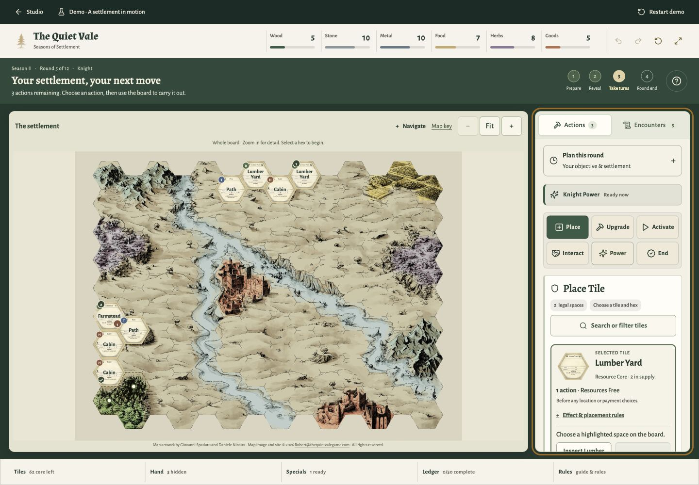
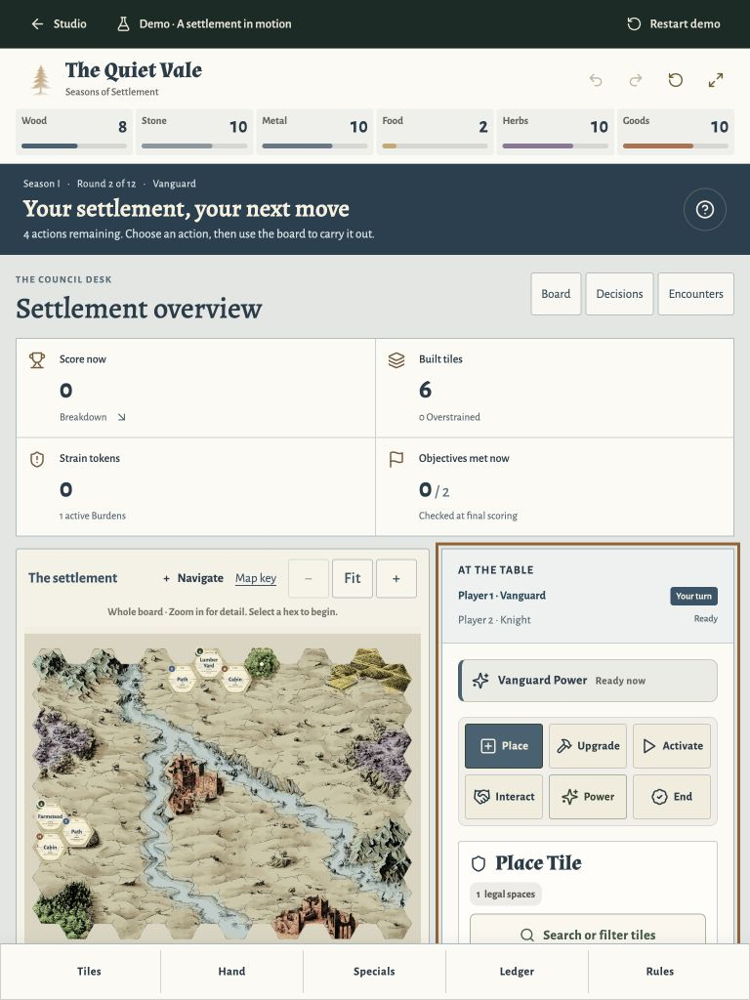
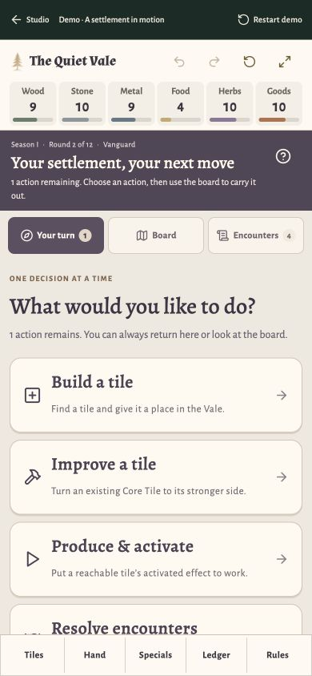
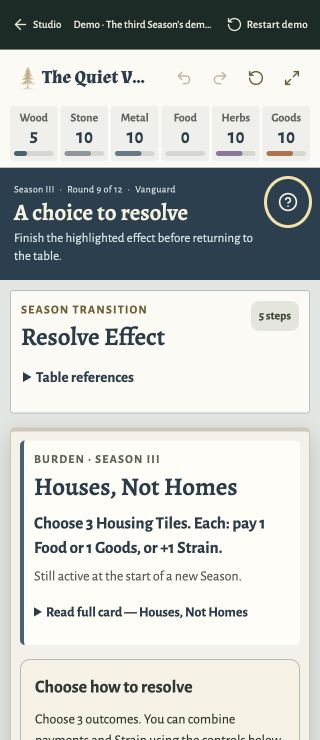
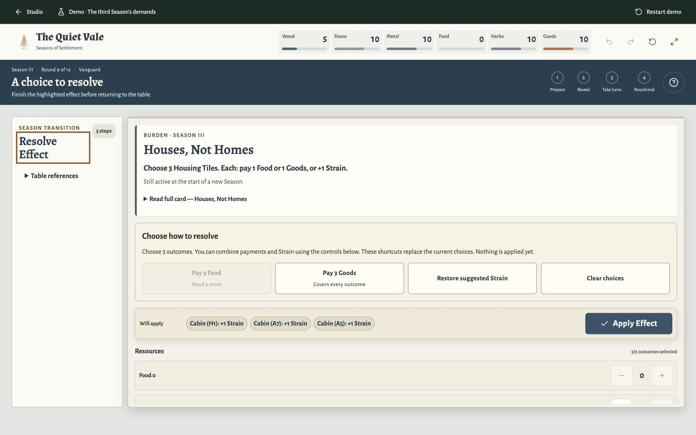
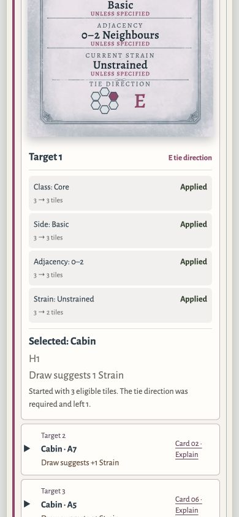
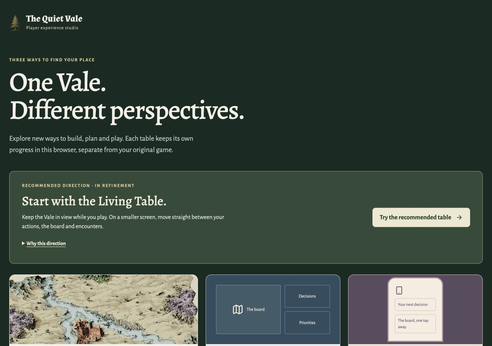

# Quiet Vale review screenshots

Captured from the working local application on **2 October 2026**. These are unedited browser JPEGs, saved locally and checked against the visible page. Viewport sizes are CSS pixels and match the image dimensions. They show preserved demo progress; use **Restart demo** in each isolated case for identical initial positions.

The native-app export attempt stalled on 27 September and was interrupted on 2 October. These files were subsequently saved through a temporary loopback-only browser form. No image generation, artwork alteration or external upload was used.

The automated suite currently passes **733 tests in 65 files**. These images establish rendered appearance only. They do not establish a full twelve-round manual playthrough, physical-device compatibility, constrained-network performance or accessibility certification.

## Living Table Desktop — 1440 × 1000

Living Table: Season II, round five, Knight, three actions; the saved eight-tile settlement. The recommended board-led design.

[Open this case](http://127.0.0.1:5174/?experience=tabletop&scenario=settlement) · [Full-size image](screenshots/living-table-desktop.jpg)

## Council Desk Tablet — 768 × 1024

Council Desk: Season I, round two, Vanguard, four actions; six tiles with score, objectives and decisions visible.

[Open this case](http://127.0.0.1:5174/?experience=council&scenario=settlement) · [Full-size image](screenshots/council-desk-tablet.jpg)

## Pocket Vale Phone — 390 × 844, updated accessibility pass

Pocket Vale: Season I, round two, Vanguard, one action; a saved seven-tile settlement. The guided intention menu keeps each choice separate from the board.

[Open this case](http://127.0.0.1:5174/?experience=guided&scenario=settlement) · [Full-size image](screenshots/pocket-accessibility-phone.jpg)

The original phone capture is [preserved here](screenshots/pocket-vale-phone.jpg). The updated capture shows clearer resource totals and action-count contrast.

## Council narrow keyboard view — 320 × 740

Revised resource totals and a pale focus ring on the dark guide. The original Season III draft remains uncommitted.

[Open this case](http://127.0.0.1:5174/?experience=council&scenario=season-three) · [Full-size image](screenshots/council-accessibility-320.jpg)

## Council Resolution Desktop — 1440 × 900

Season III, round nine: the current printed rule, payment alternatives, selected Strain outcomes and confirmation are visible before the supporting references.

[Open this case](http://127.0.0.1:5174/?experience=council&scenario=season-three) · [Full-size image](screenshots/council-resolution-desktop.jpg)

## Target Explanation Phone — 390 × 844

Scrolled phone viewport showing the expanded Target Card 16 filter trace, selected Cabin at H1 and later target summaries. This is the draw explanation, not the final payment preview.

[Open this case](http://127.0.0.1:5174/?experience=council&scenario=season-three) · [Full-size image](screenshots/target-explanation-phone.jpg)

## Comparison Studio — 1280 × 900

The local comparison entry point, recommendation and three design directions.

[Open this case](http://127.0.0.1:5174/) · [Full-size image](screenshots/comparison-studio.jpg)

The package contains eight image files, including the two accessibility updates. [Accessibility evidence and limitations](ACCESSIBILITY.md) accompany them. Exact byte counts, routes and SHA-256 hashes are recorded in [the image manifest](screenshots/manifest.json). Run instructions and the current limitations are in [the recommendation](RECOMMENDATION.md) and the worktree’s `HOLIDAY_PREVIEW.md`.
